# MySQL_Chapter5

## Table of Contents
- [Program Summary](#program-summary)
- [Collaborators](#collaborators)
- [Tech Stack](#tech-stack)
- [New Concepts Used](#new-concepts-used)
- [Exercise Queries & Console Output](#exercise-queries--console-output)
  - [Exercise 1: Full Table Backup](#exercise-1-full-table-backup)
    - [Query 1.1: Count Customer Records](#query-11-count-customer-records)
    - [Query 1.2: Create Customer Backup](#query-12-create-customer-backup)
    - [Query 1.3: Compare Customer Counts](#query-13-compare-customer-counts)
    - [Query 1.4: Verify Customer Backup](#query-14-verify-customer-backup)
  - [Exercise 2: Partial Table Backup](#exercise-2-partial-table-backup)
    - [Query 2.1A: Count All Rentals](#query-21a-count-all-rentals)
    - [Query 2.1B: Count Returned Rentals](#query-21b-count-returned-rentals)
    - [Query 2.1C: Count Unreturned Rentals](#query-21c-count-unreturned-rentals)
    - [Query 2.2: Create and Verify Returned Rental Backup](#query-22-create-and-verify-returned-rental-backup)
  - [Exercise 3: Drop Backup Tables](#exercise-3-drop-backup-tables)
  - [Exercise 4: Insert Without Column List](#exercise-4-insert-without-column-list)
    - [Query 4.1A: Insert and Verify City](#query-41a-insert-and-verify-city)
    - [Query 4.1B: Insert and Verify Address](#query-41b-insert-and-verify-address)
    - [Query 4.1C: Insert and Verify Customer](#query-41c-insert-and-verify-customer)
  - [Exercise 5: Insert With Column List](#exercise-5-insert-with-column-list)
  - [Exercise 6: Update Customer Records](#exercise-6-update-customer-records)
  - [Exercise 7: Update Customer Addresses](#exercise-7-update-customer-addresses)
  - [Exercise 8: Delete Records](#exercise-8-delete-records)

## Program Summary

This repository contains MySQL scripts demonstrating the use of CREATE, INSERT, UPDATE, and DELETE statements using the Sakila sample database.

The assignment covers creating full and partial table backups, inserting records into related tables, updating customer information, and deleting records. It also demonstrates the importance of primary keys, foreign keys, and verifying database changes after executing SQL statements.

## Collaborators

**Muhammad Bilal**  
GitHub: [@mbilalcyber](https://github.com/mbilalcyber)

## Tech Stack

- Database Engine: MySQL
- Database Schema: Sakila Database
- SQL Workbench: MySQL Workbench

## New Concepts Used

- Creating table backups using `CREATE TABLE AS SELECT`
- Filtering records using `WHERE`
- Counting records using `COUNT(*)`
- Comparing original and backup tables
- Verifying tables using `CHECKSUM TABLE`
- Inserting records using `INSERT INTO`
- Inserting records with and without column lists
- Updating records using `UPDATE` and `SET`
- Deleting records using `DELETE`
- Understanding primary key and foreign key relationships
- Verifying database changes using `SELECT`

## Exercise Queries & Console Output

### Exercise 1: Full Table Backup

#### Query 1.1: Count Customer Records

**GOAL:** Return the total number of records in the original customer table before creating a backup.

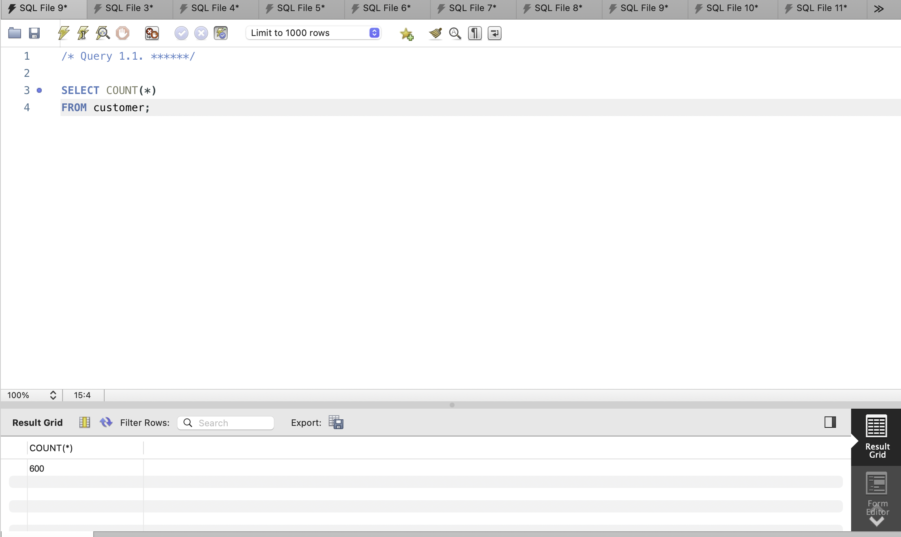

#### Query 1.2: Create Customer Backup

**GOAL:** Create a complete backup of the customer table using `CREATE TABLE AS SELECT`.

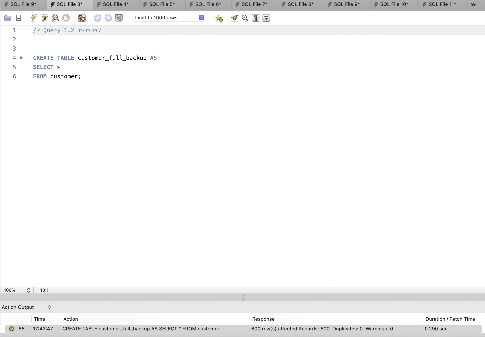

#### Query 1.3: Compare Customer Counts

**GOAL:** Compare the number of records in the original customer table with the number of records in the backup table to make sure they match.

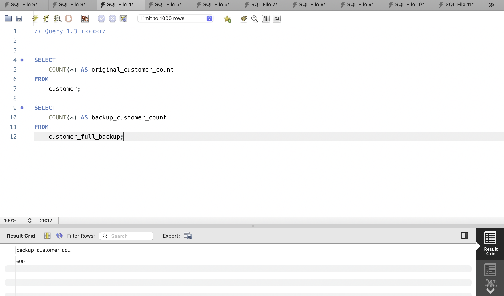

#### Query 1.4: Verify Customer Backup

**GOAL:** Use `CHECKSUM TABLE` to verify that the original customer table and its backup contain matching data.

### Exercise 2: Partial Table Backup

#### Query 2.1A: Count All Rentals

**GOAL:** Return the total number of records in the rental table.

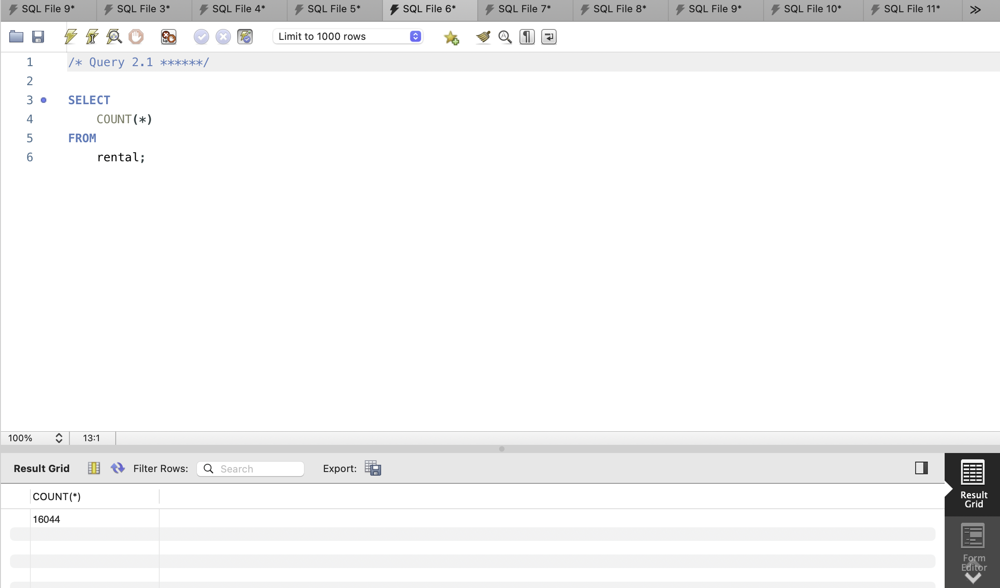

#### Query 2.1B: Count Returned Rentals

**GOAL:** Count the rental records that have been returned by checking for records where `return_date IS NOT NULL`.

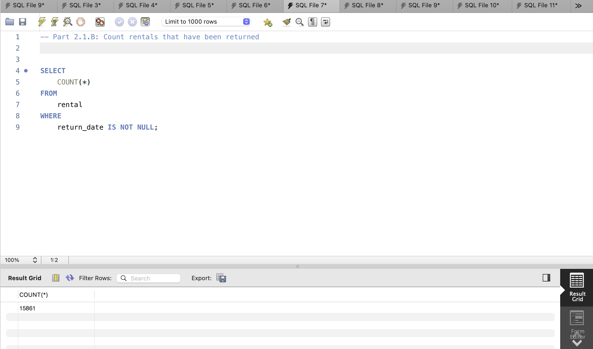

#### Query 2.1C: Count Unreturned Rentals

**GOAL:** Count the rental records that have not been returned by checking for records where `return_date IS NULL`.

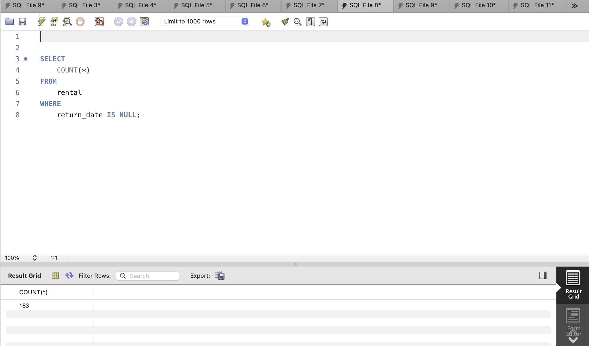

#### Query 2.2: Create and Verify Returned Rental Backup

**GOAL:** Create a partial backup of the rental table containing only returned rentals. Verify that the backup contains the same number of records as the returned rental count from Query 2.1B.

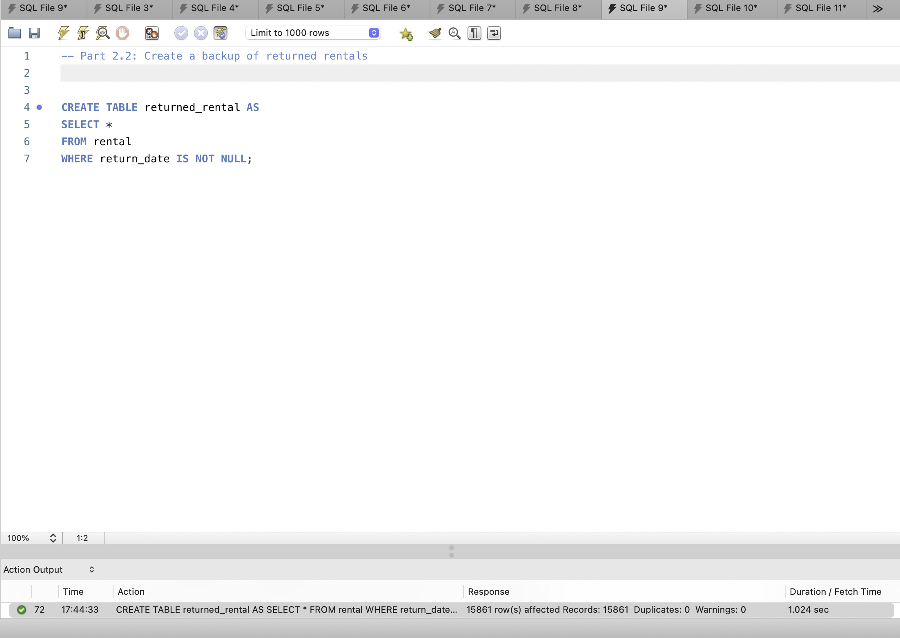

### Exercise 3: Drop Backup Tables

**GOAL:** Drop the backup tables created in Exercises 1 and 2, then verify that both tables have been removed from the database.

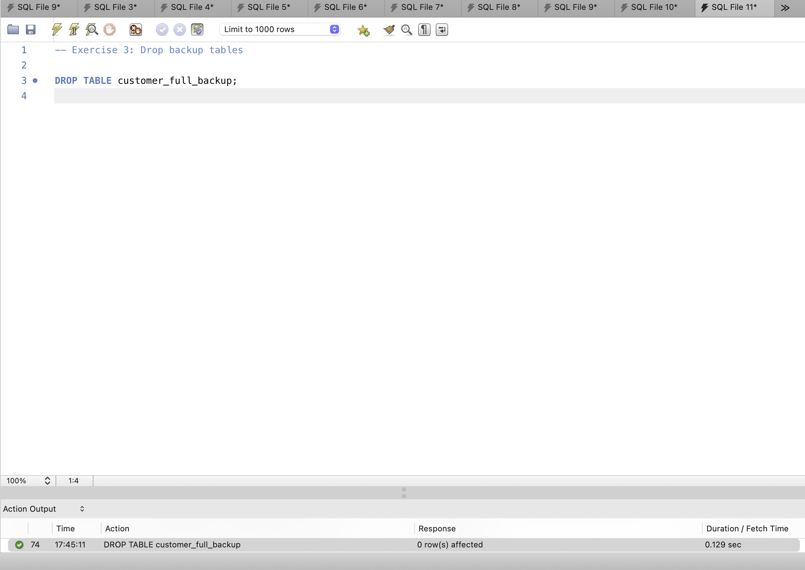

### Exercise 4: Insert Without Column List

#### Query 4.1A: Insert and Verify City

**GOAL:** Insert a new city into the city table using country ID 103. Verify that the city was inserted successfully.

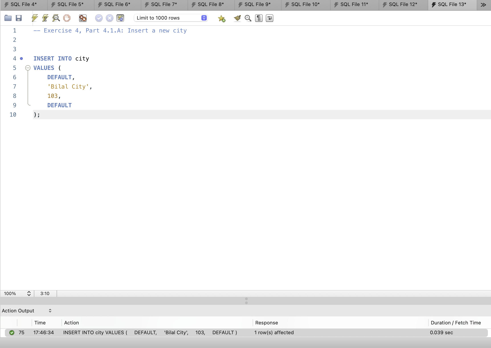

#### Query 4.1B: Insert and Verify Address

**GOAL:** Insert a new address associated with the newly created city. Verify that the address record was inserted successfully.

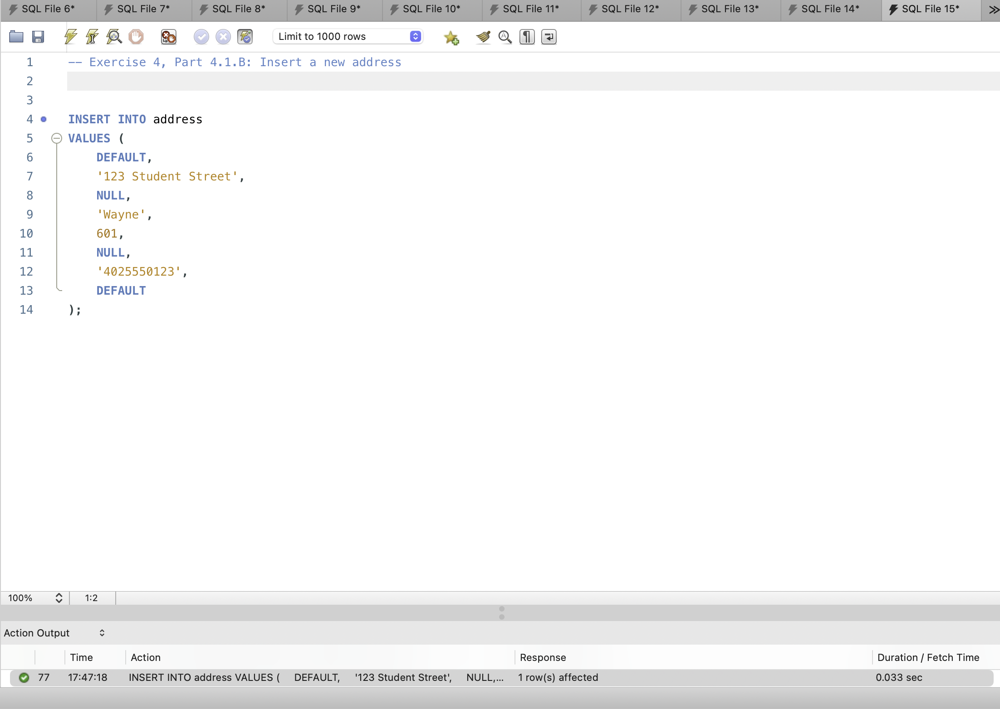

#### Query 4.1C: Insert and Verify Customer

**GOAL:** Insert a new customer using the newly created address and store ID 1. Verify that the customer record was inserted successfully.

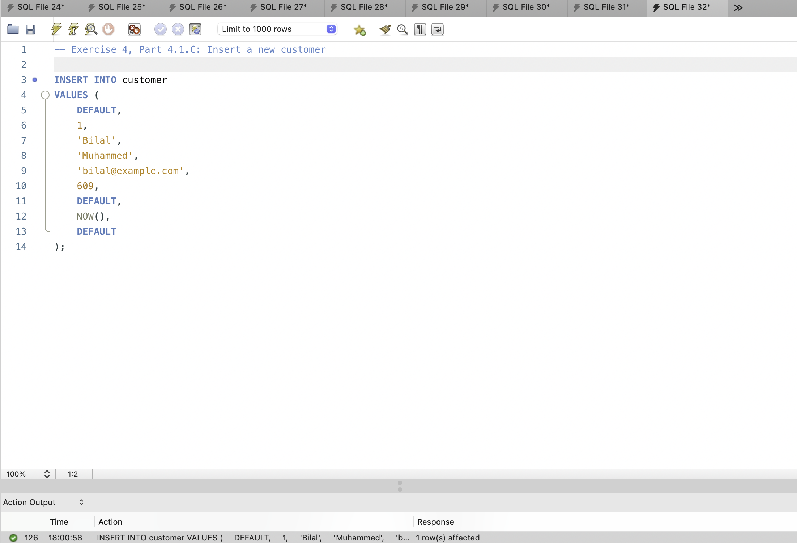

### Exercise 5: Insert With Column List

**GOAL:** Insert a second customer by specifying the column names. Allow auto-increment, default, and nullable columns to use their appropriate values, then verify the new customer record.

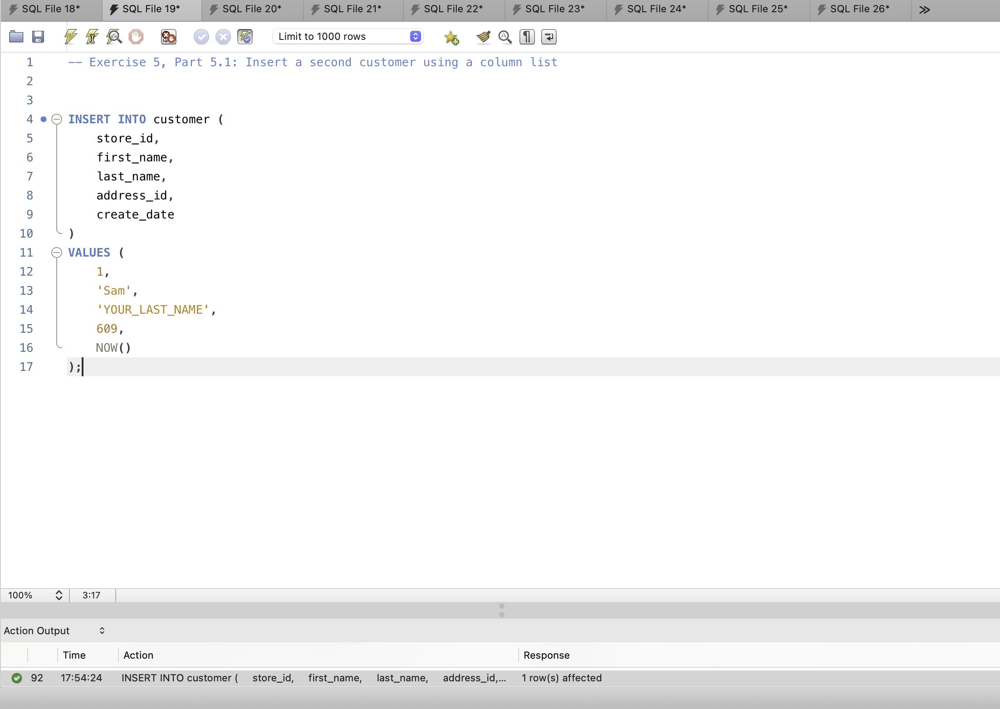

### Exercise 6: Update Customer Records

**GOAL:** Update both newly inserted customer records individually by changing their store IDs to 2 and assigning email addresses. Verify that the changes were applied correctly.

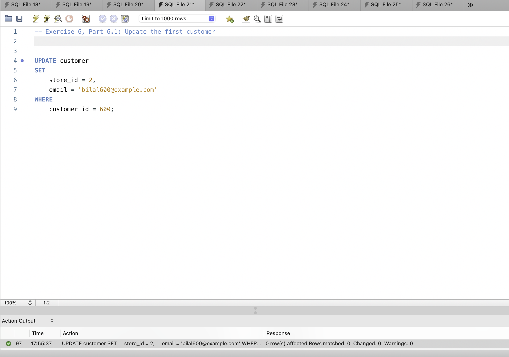

### Exercise 7: Update Customer Addresses

**GOAL:** Update both customer records by changing their address ID from 606 to 605. Verify that both customers now reference the updated address.

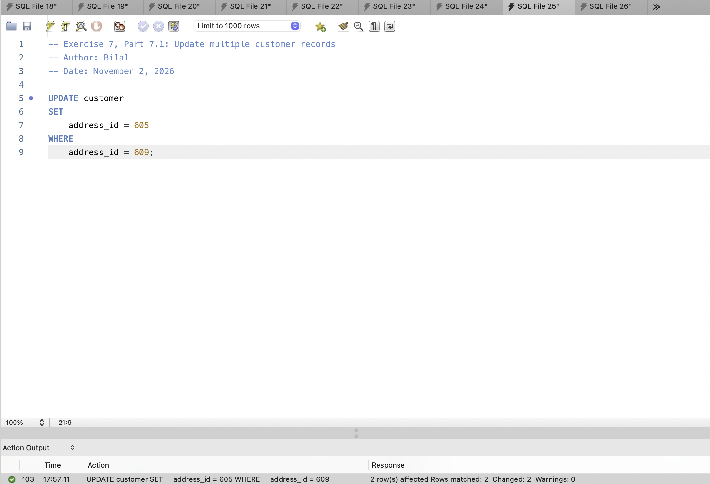

### Exercise 8: Delete Records

**GOAL:** Delete the records created during the assignment, including the city, address, and both customer records. Verify the deletions and document any issues encountered and how they were resolved.

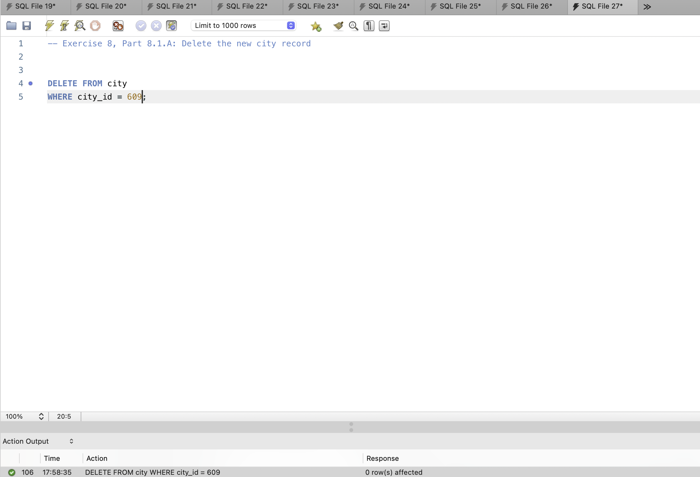
